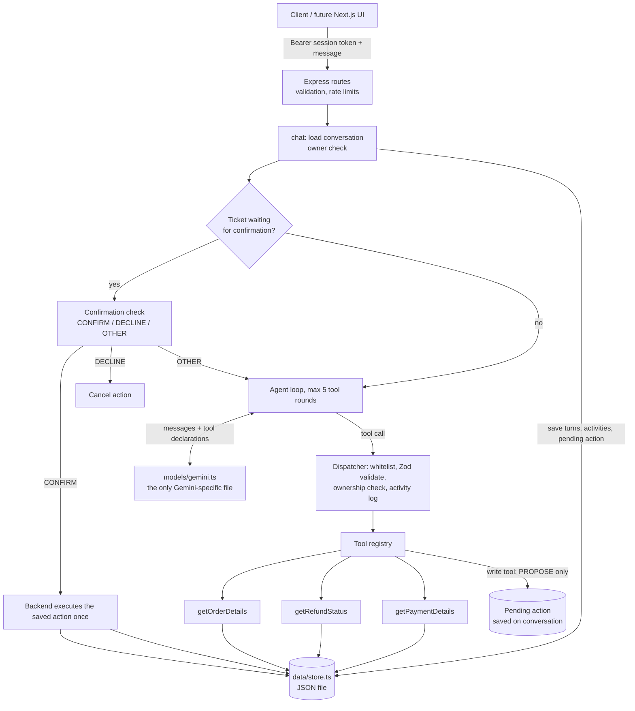

# ResolveAI Lite

A small, real AI **customer-support investigation agent** (backend only), built to learn how agent backends work.

A fictional customer says *"I returned my headphones, but my refund has not arrived."* The agent:

1. lets **Gemini decide** which of four tools to call (order, refund, payment lookups),
2. explains what the records show, **without inventing anything**,
3. offers a support ticket, **asks for confirmation**, and
4. only then creates a real ticket, **once**.

Stack: Node.js, TypeScript (strict), Express, the official `@google/genai` SDK, Zod, local JSON demo data, Vitest.
No LangChain, no database server, no vector DB. A Next.js UI can be added later on top of this API.

> **Learning/demo project.** Data is stored in a JSON file and assumes a **single server process**. It is not production storage.

---

## Quick start

Requirements: Node.js 20.12 or newer.

```bash
npm install
cp .env.example .env        # Windows PowerShell: copy .env.example .env
# edit .env and set GEMINI_API_KEY (free key: https://aistudio.google.com/apikey)
npm run dev                 # http://localhost:3000
```

| Script | What it does |
| --- | --- |
| `npm run dev` | Start the server with auto-reload |
| `npm run build` / `npm start` | Compile to `dist/` and run it |
| `npm test` | Run all tests (**no API key needed**, Gemini is mocked) |
| `npm run try:agent` | Chat with the agent in your terminal (needs a key) |
| `npm run check:live` | Smoke-test the REAL model on refund wording and the one-"yes" ticket flow (needs a key, ~10 model calls) |
| `npm run try:tools` | Call the four tools by hand, no AI |

### `.env`

| Variable | Meaning |
| --- | --- |
| `GEMINI_API_KEY` | Your key. Server-side only, never returned by any endpoint. Without it, `/api/chat` answers `503`. |
| `GEMINI_MODEL` | Model used for function calling. Default `gemini-3.1-flash-lite`. Check the [current model list](https://ai.google.dev/gemini-api/docs/models) if a name stops working. |
| `PORT` | Default `3000` |
| `DATA_FILE` | Where the demo "database" lives (default `data/runtime.json`, created from `data/seed.json` on first run). Delete it to reset the demo. |

`.env` and the runtime data files are git-ignored.

---

## How it works



### The agent loop (`src/agent/agent.ts`)

An "agent" is just a loop around a model that can ask for tools:

1. Send Gemini the system instructions, recent history, and the tool declarations.
2. If Gemini replies with **text** → that is the answer. Done.
3. If Gemini replies with **tool calls** → for each one the backend checks the tool is registered, validates the arguments with Zod, runs it (the tool checks ownership), records an activity event, and sends the result back to Gemini. Go to step 1.
4. After **5 tool rounds** it stops with a safe message.

Gemini picks the tools and their order. Nothing is hardcoded as order → refund → payment, and there is no keyword matching.

### Safe ticket creation (`src/agent/actions.ts`)

A write never happens just because the model asked.

1. **Propose.** The model calls `createSupportTicket`. The backend only checks the order is yours and no identical open ticket exists, then saves a **pending action** on the conversation. The model is told "NOT created yet, ask the customer".
2. **Confirm.** On the customer's next message, a tiny separate model call sees *only* the pending summary and that message, and answers `CONFIRM`, `DECLINE` or `OTHER`. Anything other than exactly `CONFIRM` means no write.
3. **Execute.** The **backend**, not the model, re-validates the saved arguments, re-checks ownership, and writes once. The reply text is built from the real result, so a ticket ID is only quoted if it exists.

**One "yes" is enough.** If the model offers a ticket in words but forgets to prepare one, the loop notices (a tiny YES/NO check on its reply, only after it used tools) and asks it once to call `createSupportTicket`. That nudge is never saved or shown, so the customer still confirms only once. Authorization and idempotency are unchanged: a "yes" with no pending action never creates anything.

**No duplicates:** the store writes a ticket only if neither this action nor an identical open ticket (same customer + order + category) already exists, and requests for one conversation run one at a time. Sending "yes" twice, even simultaneously, makes one ticket.

### Memory (`src/agent/memory.ts`)

Gemini remembers nothing between calls. Each conversation is saved in our own JSON store and the **last 24 turns** are replayed on every request (always starting on a user message). Tool lookups are saved as short notes, so *"Why is it still pending?"* still knows which refund was discussed. The pending action is stored as structured state, separate from model text. There is no summarization and no vector memory.

### Activity events

Every real tool execution is recorded and returned by `POST /api/chat`:

```json
{ "tool": "getRefundStatus", "status": "success",
  "startedAt": "2026-10-12T10:00:01.120Z", "completedAt": "2026-10-12T10:00:01.125Z",
  "inputSummary": "orderId=ORD-1001", "outputSummary": "ok" }
```

`status` is one of:

| status | meaning |
| --- | --- |
| `success` | The tool really ran (a lookup, or a ticket write **after** the customer confirmed). |
| `awaiting_confirmation` | The model **proposed** a write. Nothing was changed. |
| `error` | Blocked or failed (unknown tool, bad arguments, not found, duplicate...). |
| `started` | Only seen if a tool is still running. |

So a ticket shows `awaiting_confirmation` in the request that proposed it and `success` in the request where the customer said yes.
They are real events, not fake progress. A later SSE stream or UI panel can reuse the same shape.

### Project layout

```
src/
  index.ts              starts the server
  app.ts                builds the Express app (also used by tests)
  api/
    chat.routes.ts      the HTTP endpoints
    session.ts          demo profiles + server-issued session tokens
    http.ts             JSON errors + rate limiter
  agent/
    agent.ts            chat() entry point + the agent loop
    actions.ts          pending actions: propose / confirm / execute
    dispatch.ts         runs ONE tool call safely + records the activity
    memory.ts           saving/loading conversations, bounded history
  tools/
    registry.ts         the list of tools the agent knows about
    order.tool.ts  refund.tool.ts  payment.tool.ts  ticket.tool.ts
  models/
    gemini.ts           ALL Gemini-specific code
    types.ts            provider-neutral message types
  prompts/system.ts     system instructions
  data/store.ts         JSON "database" functions
  utils/config.ts       validated environment
data/seed.json          fictional demo data
tests/                  Vitest, Gemini mocked
```

---

## Demo data

Everything is fictional (`*.example.test` emails). A visitor picks a **profile**; the server issues a session token for that customer. Order IDs you type are never treated as proof of ownership: every tool checks the order belongs to the session's customer, and other people's orders look exactly like unknown ones ("not found").

| Profile | Order | Product | Scenario to try |
| --- | --- | --- | --- |
| `alice` | `ORD-1001` | Wireless Headphones | Returned. Refund **initiated, but the bank transfer failed** (`TXN-9001`, account closed). The main demo. |
| `alice` | `ORD-1002` | Mechanical Keyboard | Returned. Refund **completed**. |
| `alice` | `ORD-1003` | Phone Case | Delivered, no return, no refund. |
| `ben` | `ORD-2001` | Smart Watch | Returned. Refund **pending** (transfer still processing). |
| `ben` | `ORD-2002` | USB-C Hub | **Possible duplicate charge**: two identical charges, `TXN-8005` and `TXN-8006`. |
| `ben` | `ORD-2003` | HD Webcam | Shipped, not delivered yet. |
| `chloe` | `ORD-3001` | Travel Backpack | **Delivered but customer says it never arrived.** The agent can show the delivery record and offer a ticket; it has no courier tools and says so. |
| `chloe` | `ORD-3002` | Yoga Mat | Shipped. |
| `chloe` | `ORD-3003` | E-Reader | Not shipped; **payment failed** (card declined). Already has ticket `TCK-7001`. |
| any | `ORD-9999` | – | **Unknown order.** Also what you get for another customer's order. |

---

## HTTP API

Errors always look like `{ "error": { "code": "...", "message": "..." } }`.

| Method & path | Auth | Purpose |
| --- | --- | --- |
| `GET /health` | – | `{ "status": "ok" }` |
| `GET /api/profiles` | – | Selectable demo profiles |
| `POST /api/session` | – | Body `{ "profile": "alice" }` → `{ sessionToken, profile, name }` |
| `POST /api/chat` | Bearer | Body `{ "conversationId"?: string, "message": string (1–1000 chars) }` → `{ conversationId, reply, activities, pendingAction? }` |
| `GET /api/conversations/:id` | Bearer | `{ messages, activities, pendingAction? }`, owner only |
| `GET /api/tickets` | Bearer | Tickets of the current session's customer only |

Status codes: `400` bad request / unknown profile · `401` missing or expired session · `404` unknown **or not yours** conversation · `413` body over 10 kB · `429` rate limited (20 chat requests/min per session, 10 new sessions/min per IP) or Gemini quota · `502` / `503` / `504` AI service problems · `500` unexpected.

### Try it with curl

(Use Git Bash, macOS or Linux. In PowerShell use `curl.exe` and `Invoke-RestMethod` instead.)

```bash
B=http://localhost:3000

# 1. Pick a demo identity and keep the token
TOKEN=$(curl -s -X POST $B/api/session -H 'content-type: application/json' \
  -d '{"profile":"alice"}' | node -pe 'JSON.parse(require("fs").readFileSync(0)).sessionToken')

# 2. Ask the question
curl -s -X POST $B/api/chat -H "authorization: Bearer $TOKEN" -H 'content-type: application/json' \
  -d '{"message":"I returned my headphones but have not received my refund."}'
# -> note "conversationId" and "pendingAction" in the response

# 3. Confirm (use YOUR conversationId)
curl -s -X POST $B/api/chat -H "authorization: Bearer $TOKEN" -H 'content-type: application/json' \
  -d '{"conversationId":"conv_xxxxxxxx","message":"Yes, please."}'

# 4. See the ticket, and the saved conversation
curl -s $B/api/tickets -H "authorization: Bearer $TOKEN"
curl -s $B/api/conversations/conv_xxxxxxxx -H "authorization: Bearer $TOKEN"
```

### Example conversations

**Failed refund → ticket** (`alice`)

| You | Agent does |
| --- | --- |
| I returned my headphones but have not received my refund. | Calls order, refund and payment tools. Explains the refund was initiated but the bank rejected the transfer. Prepares a ticket and asks *"Create a ticket?"* (`pendingAction` is returned). |
| Yes, please. | Backend creates ticket `TCK-…` and replies with its real ID. |
| Yes, please. *(again)* | No second ticket is created. |

**Follow-up using memory** (`ben`)

| You | Agent does |
| --- | --- |
| Where is the refund for ORD-2001? | Looks up the refund: pending. |
| Why is it still pending? | Knows "it" means the ORD-2001 refund from memory and explains only what the records show, offering a ticket if it cannot verify more. |

**Can't verify** (`chloe`): *"ORD-3001 says delivered but I never got it."* → reports the delivery record, says it cannot verify what happened to the package, and offers a ticket.

---

## Guardrails

| Risk | Defence |
| --- | --- |
| Model invents facts or claims success | System prompt rules; ticket IDs in replies come from the backend result, never from model text |
| Overclaiming refunds | Our data only says what *our system* did (refund `completed`, transfer `success`). The agent checks the payment record and must say it cannot see the bank's side: no arrival dates, no "funds received" |
| Customer identity spoofing | Identity only from a server-issued session token; request bodies and model arguments can't set it |
| Reading other customers' data | Every tool checks order ownership; other people's orders look like "not found"; conversations/tickets are owner-only |
| Model calls a made-up or malformed tool | Tool whitelist (registry) + Zod validation; the model gets an error it can read |
| Ticket created without consent | Write tools only **propose**; execution needs a pending action + confirmation check; anything but `CONFIRM` = no write |
| Duplicate tickets | Idempotency key per action, open-ticket check inside the store, one request at a time per conversation |
| Runaway loops / abuse | Max 5 tool rounds; 1000-char messages; 10 kB bodies; per-session and per-IP rate limits |
| Secrets / internals leaking | Key stays server-side; auth failures return a generic 503; no stack traces; tool notes and saved arguments are never returned |
| Partial failures | Failed Gemini call saves nothing (resend safely); failed write reports failure and is never retried automatically |

---

## Tests

`npm test` runs 70+ tests with **Gemini mocked**, so no key or network is needed. They cover tool dispatch, a regression file for the tester feedback (single confirmation, refund wording rules, activity statuses, unauthorized access, duplicate tickets), order ownership, missing records, refund/payment retrieval, required confirmation, duplicate prevention, memory across a restart, rate limits, error mapping, and the full acceptance scenario over real HTTP.

> The mocked tests prove the backend logic. They do **not** prove that the real Gemini model behaves well. `npm run check:live` checks a few of those behaviours on the real model (heuristic, not a guarantee), and `npm run try:agent` lets you try anything yourself.

---

## Limitations (on purpose)

- **JSON file storage, single process.** Writes are serialized and atomic (temp file + rename), but two server processes would overwrite each other.
- **In-memory sessions and rate limits.** A restart signs everyone out.
- **Demo isolation is per profile.** Everyone who picks `alice` shares Alice's conversations and tickets. Fine for a private demo; a public deployment would add per-visitor data.
- **No CORS or HTTPS configured.** Put a proxy in front, or add CORS when the Next.js UI needs it.
- **No streaming.** Replies arrive whole.
- **Four tools only.** For delivered-but-missing packages the agent can't investigate couriers.

---

## Extending it later

| Goal | What changes |
| --- | --- |
| **Add a tool** (`checkWarranty`, `trackShipment`, `sendEmail`) | New `tools/xyz.tool.ts` + one entry in `tools/registry.ts`. The agent loop doesn't change. A tool that changes data adds an `action` block to get the confirmation flow for free. |
| **RAG** | Add ingestion/embedding code, a vector store (e.g. pgvector), and `tools/knowledge.tool.ts` with `searchKnowledgeBase()`, registered like any tool. Nothing else changes. |
| **PostgreSQL** | Rewrite the functions in `data/store.ts` (+ migrations). Tools and the agent call those functions, so they stay the same. |
| **Another model (Claude / OpenAI)** | New adapter with the same `generate()` as `models/gemini.ts`, and change one import in `agent.ts`. Expect to re-test: providers format tool calls and results differently. |
| **Streaming** | Add an SSE endpoint that forwards token chunks and the existing activity events. |
| **Multiple agents** | Only add routing if a real use case needs it. |

### Why a hand-written loop instead of the SDK's automatic tool calling?

The SDK can run tools for you, but then you can't insert validation, ownership checks, the confirmation gate, or activity logging between the model's request and the tool running. The loop is about 40 lines, and writing it is the best way to understand how agents work.
